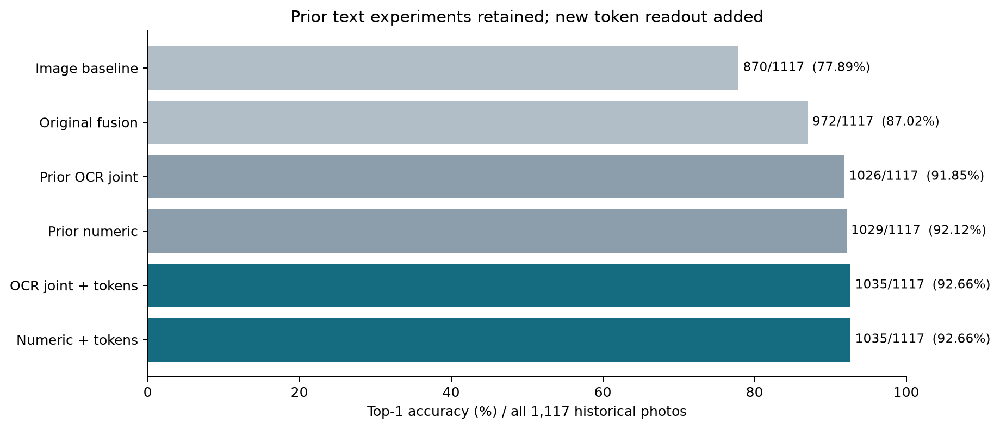
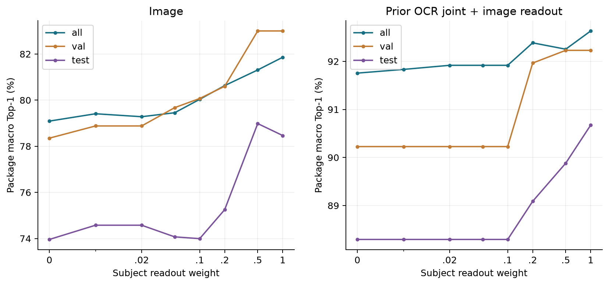
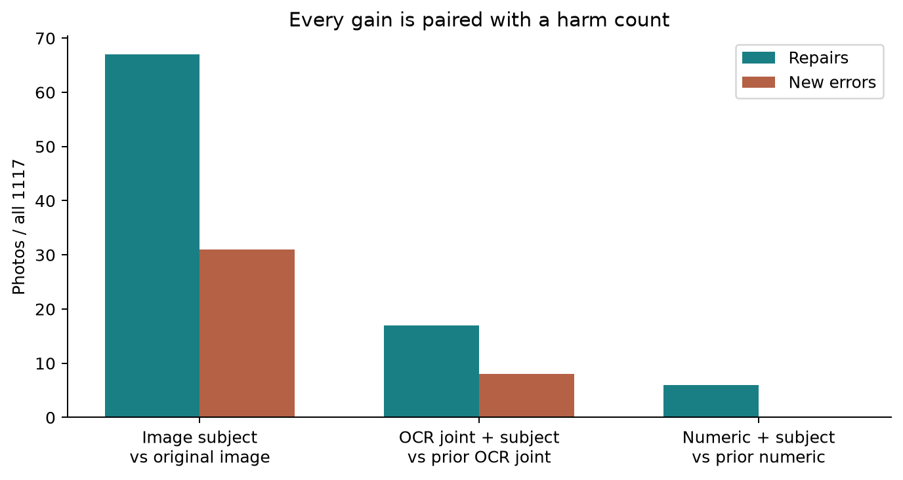
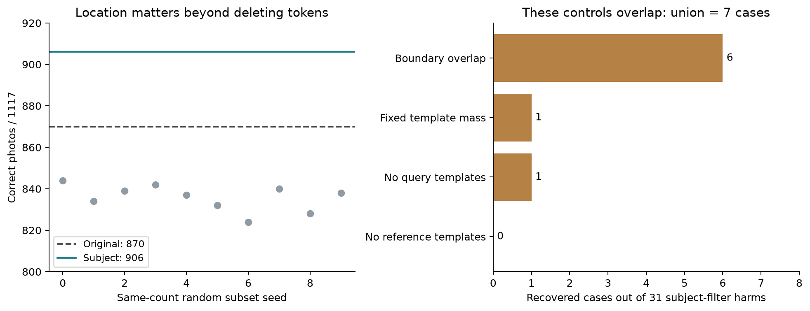
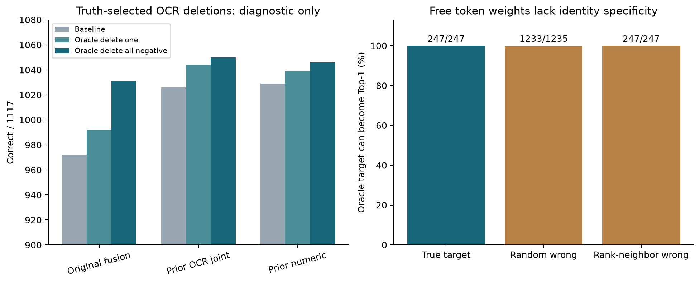
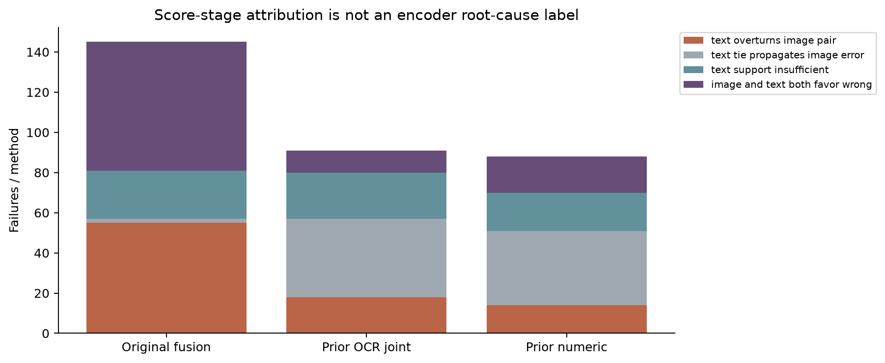

# ColNomic 全量错误归因与修复实验报告

本轮完成 1117 张照片、130 个包装身份、5405 行参考图的冻结特征实验。排名按图像 SHA 合并为 5330 个参考；原图像、原融合、既有文字联合修正、既有数值分词四种方案的错误并集为 292 张，其余 825 张作为共同成功对照。全部 1117 张均有逐例记录，包括新方法新增的错误。

**主要结论：错误来自多条链路，不能统一归因于编码器。主体 Token 读出能够改善整体排名，但也会损害成功样本；自由 Token 调权对错误身份同样有效，不能作为“身份信息已被编码”的证明。** 对所有失败已完成计分层归因和干预记录；这不等于每张图的像素、编码或语义根因都已被因果实验证实。

[图片版逐例浏览器](REPORT.html)（下载本目录后打开，照片和正确参考图均可点击） · [逐图归因表](all1117_attribution.csv) · [精确统计](REPORT_FACTS.json) · [独立验证](LOCAL_VALIDATION.json) · [既有文字联合实验](prior_text_joint_results.csv) · [既有细粒度机制证据](prior_mechanism_findings.txt)

## 整体结果与比较对象

| 方案 | 正确数 | Top1 |
| --- | ---: | ---: |
| 原图像检索 | 870/1117 | 77.89% |
| 原融合 | 972/1117 | 87.02% |
| 既有主体 OCR＋文字计分修正 | 1026/1117 | 91.85% |
| 既有数值分词版本 | 1029/1117 | 92.12% |
| 文字联合修正＋本轮主体 Token | 1035/1117 | 92.66% |
| 数值分词版本＋本轮主体 Token | 1035/1117 | 92.66% |

既有文字联合实验直接沿用：主体 OCR＋文字计分修正在全量上相对原融合修复 65 张、损害 11 张，净增 54 张；在多物体 253 张上为 225/253，相对 195/253 修复 34 张、损害 4 张；26 例重点人工复核中修复 19 例。原有“数字连写产生伪规格”和数值分词新增错误的结论保留，不将旧收益记为本轮新增发现。

新主体 Token 权重仅根据原有验证集的包装宏平均 Top1、宏平均 MRR、较小权重依次选择。图像和文字联合版本选择 1；数值分词版本选择 0.2。训练、验证、测试分别为 783/173/161 张、91/21/18 个包装身份。人工主体框提供额外监督，历史测试集已被研究，不能称为新盲测。

## 冻结特征后改变读出的效果

主体 Token＋模板 Token 的图像读出为 906/1117，相对 870/1117 修复 67 张、损害 31 张。十组保留相同视觉 Token 数量的随机筛选仅为 824–844/1117，说明主体位置选择的效果不同于任意删 Token。全量包装宏平均变化为 +2.77 个百分点，按包装重采样的 95% 区间为 +0.53 到 +5.09；历史测试集变化 +4.51 个百分点，区间 −1.66 到 +11.61，单独测试子集尚不精确。

将主体 Token 读出加入既有文字联合修正，1026→1035，修复 17、损害 8。加入既有数值分词版本，1029→1035，修复 6、损害 0。两者正确数相同，不表示修复的是同一批照片。保持原图像归一化参数时分别为 1032 和 1034，说明归一化变化也会影响最终融合排名。

即使允许对每张原图像失败照片用真值选择最有利的全图与主体分数凸混合，中心规则也只能覆盖 71/247 个失败；完整包含规则 65/247、面积权重 70/247。由此可排除“只需为全体统一调一个主体权重就能修复所有图像错误”。

## 去背景为什么会新增错误

**背景位置的 Token 有利于某个候选，不等于真实背景像素提供了身份信息。** Token 经过上下文编码；边界 Token 可能覆盖药盒；MaxSim 匹配与权重聚合也可能利用偶然相关。

针对新增的 31 例，全图库对照如下。

| 对照 | 31 例中恢复正确 | 全量正确 |
| --- | ---: | ---: |
| 保留一切与主体框相交的 Token | 6 | 904 |
| 保持原有模板 Token 总占比 | 1 | 907 |
| 主体区域仅保留视觉 Token | 1 | 908 |
| 主体读出只匹配参考图视觉 Token | 0 | 898 |

前三种对照的恢复集合存在重叠，四项并集为 7 例，另 24 例未被这些对照恢复。扩大边界支持了其中 6 例对边界保留规则敏感；固定模板占比仅解释少量计分变化。禁止参考模板匹配没有救回这 31 例，不能把这批退化主要归给模板匹配。背景视觉 Token 单独读出在其中 26 例正确，也只是原特征计分事实，不能证明背景语义；剩余解释需要像素遮挡及对应区域重编码来区分上下文、边界漏标和偶然匹配。

## 自由调权对照否定了一个过强推论

在原缓存上，对每张图独立优化非负 Token 权重，约束权重和为 1，并同时对全部错误参考图最大化最小正负分差。247/247 个原图像失败都有严格 Top1 解；只允许主体＋模板 Token 时为 246/247，另 1 例落在零间隔边界。

**这一现象不具备身份特异性。** 同样优化 1235 个随机错误参考目标，1233/1235 也能排第一；选择原真值排名旁边的错误参考作为目标时，247/247 同样成功。因此，这个高自由度、逐图使用目标标签的优化只能证明当前评分空间允许这些排名，不能证明编码器已保留可泛化的实例身份信息，也不能作为可部署修复方法。

本机独立使用原缓存和 CPU 双精度复算了 494 份权重及 3868 个候选对，最大活动约束分差误差 1.76e-7；优化原始及对偶界最大间隙 7.43e-13。检验未失败，是对照否定了其身份解释。

## 文字链路新增验证及既有联合实验

不重做主体 OCR、文字计分与分词联合实验。本轮新增的是对全量剩余错误的行级删除：使用真值正负候选差，选择最不利的一行或全部不利行，并在完整图库重新排名。另有十组同数量随机删行；同时保留固定归一化与重新归一化两种结果。

| 既有基准 | 基准正确 | 删除最不利一行 | 删除全部不利行 | 全部删除修复／损害 |
| --- | ---: | ---: | ---: | ---: |
| 原融合 | 972 | 992 | 1031 | 76／17 |
| 文字联合修正 | 1026 | 1044 | 1050 | 24／0 |
| 数值分词版本 | 1029 | 1039 | 1046 | 18／1 |

删除方案用到了真值，属于诊断实验。负贡献 OCR 行不自动等于识别错误；它也可能是正确识别的公共词、其他物体文字或未选中的规格表。文字联合修正后的同数量随机删行只修复 1–5 例、损害 3–10 例。固定归一化下，定向全部删行修复 22/91 例；重新归一化为 24/91，说明收益主要来自删除的词项贡献，归一化另有影响。

## 每个错误的计分阶段归因

| 方案 | 文字推翻图像正优势 | 文字平分而继承图像错误 | 文字支持不足以救回 | 图像文字同时偏向错误 |
| --- | ---: | ---: | ---: | ---: |
| original | 55 | 2 | 24 | 64 |
| center_presence | 18 | 39 | 23 | 11 |
| numeric | 14 | 37 | 19 | 18 |

这里按各方案的正确参考与该方案最强错误参考计算分差。例如原融合的 55 例“文字推翻图像正优势”是固定候选对上的事实；原图像全图库正确、融合变错则是 41 例，二者统计对象不同。

[1117 行记录](all1117_attribution.csv)含原四方案排名、验证集选定新方案排名、文字与图像对最强错误候选的分差、删行结果、匹配对照、修复方向和证据边界。292 个原基准错误均有记录，没有把缺少像素干预的案例硬贴为“编码器丢失信息”。原图像和融合的错误并集为 288；加入已有文字修正与分词方案新增错误后为 292。

## 既有受控实验已经确认的机制

容量 250mL/100mL 案例在原缓存上有局部正信号；全图与容量区域读出适度混合可在完整图库从第 2 到第 1，单独 ROI 却只到第 4。它确证该例的读出权重影响，不能推广为所有 ROI 均能修复。

Mucus DM 的方向、对应说明面和成分行共同影响匹配。受控数字画布上，按成分行对应的分差 +0.147809；控制候选 Token 数量后 +0.137912。遮数字相比遮等面积公共字母额外减少 0.013684 的分差。这是在该受控输入下的数字外观与行对应证据。新运行时的参考特征与旧缓存不同，不能把新干预直接当作对旧缓存内部过程的复原。

Bravecto 共有侧面的换行差异确实可见，原“未确认线索”标签已修订。相关区域偏向正确候选，但全图库从第 4 只到第 2，因为另一错误规格也使用同样换行。局部排版可区分一对候选，却未必唯一确定身份。

既有身份划分冻结特征 Probe 没有取得稳定总体提升；布局特异 Probe 的测试身份太少。它们与本轮自由权重负对照共同限制结论：仍不能把全部错误判为编码器信息丢失，也不能声称换匹配即可普遍解决。

## 修复方向与验收标准

1. **保留既有文字联合修正作为工作基准。** 继续验证可部署的主体 OCR 归属、商品当前规格与公共规格表的绑定。数值分词不能直接全局替换；按包装身份独立测试新规则的修复与损害。
2. **图像端采用保守的区域读出与融合。** 主体框不能直接变成硬删除规则；边界覆盖、局部语义与图像分差置信度应一起验证。所有门控和权重仅在训练/验证身份上学习，测试 825 个共同成功对照的损害。
3. **优先研究对应面和属性关系的匹配。** 以既有 Mucus 证据为起点，约束成分行、数字与单位、当前规格区域，比较只给定位信息、只改匹配与两者联合；保留等候选数控制。主体空间规则与语义对应不能混称为一个机制。
4. **身份信息是否被编码，采用有共享参数且跨身份评估的解码检验。** 保留标签打乱、随机错误目标和相同文字的布局负对照。逐图真值调权因负对照同样成功而不能承担此证据。
5. **31 例去背景退化中的深层解释需用配对像素实验。** 在同一运行时比较原图、仅遮远离边界的背景、等面积主体无关区遮挡与边界保留；同时检查对应 Token 及完整图库排名。旧缓存可用于计分实验，新编码必须有自己的复现基线。

验收必须同时列出全图库 Top1、包装宏平均、逐场景表现、修复与新增错误；在局部候选对或精选案例上的改善不能替代全图库结论。

## 公开附件与复算资料

公开附件包含 1117 张逐例归因表、全部曲线统计、汇总结果、实验协议、代码与 1247 张经明确授权的照片和参考图缩略图。350738 条完整逐配置决策、494 份优化权重、逐行 OCR 证据及复算输入保留于本地和原服务器，未包含在公开发布中。

运行脚本使用服务器已有原始缓存与人工主体掩码，不包含密码或远程会话日志。全相似度大矩阵与新全图库浮点分数保留于实验目录，原始缓存仍以既有完整审计附件为准。`artifact_manifest.json` 校验发布文件；输入掩码与 cohort 的 SHA 在协议中。远程全量重算原图像分数最大差异 2.39e-7；OCR 基准最大复现差异 4.81e-6，全部原排名一致。

复算脚本和统计报告已公开。完整输入与逐配置数据包的公开上传未获自动审批通过，保留本地和服务器；本次授权公开的缩略图与统计报告正常发布。
